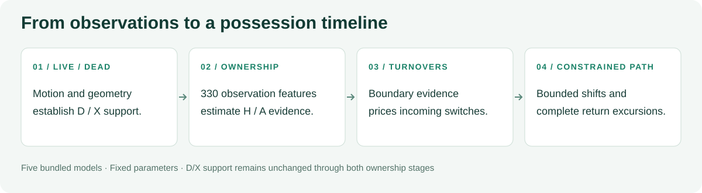
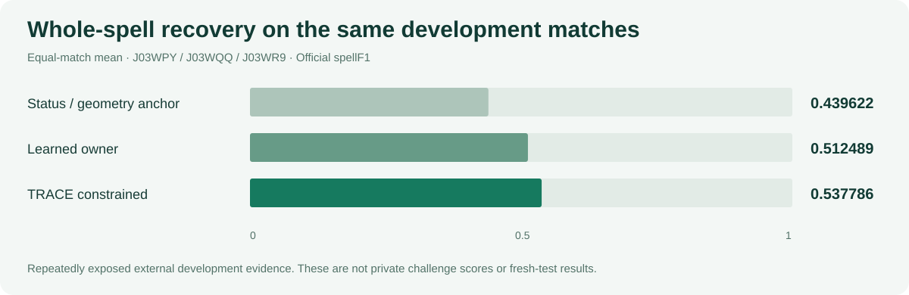

<p align="center">
  
</p>

<p align="center">
  <strong>Initial Challenge · Frame-level Ball Possession</strong><br>
  <a href="#the-approach">Approach</a> ·
  <a href="#reproduce-the-possession-file">Reproduce</a> ·
  <a href="#measured-evidence">Evidence</a> ·
  <a href="docs/MODEL_CARD.md">Model &amp; data</a> ·
  <a href="docs/technical-report.pdf">Technical report</a>
</p>

TRACE turns automatic tactical tracking into a complete **home / away / dead-ball / unknown** timeline. It combines learned ownership evidence with a constrained sequence decoder, aiming to recover whole possessions while retaining credible handovers.

The football distinction matters: a pass, loose ball, deflection or contested touch does not automatically transfer possession. The controlling team remains the owner until the opposition establishes control. The challenge evaluates whether those complete intervals are recovered—not simply whether nearby frames look similar.

| Input | Output | Primary metric | Runtime |
|---|---|---|---|
| Automatic tactical tracking TXT + XML metadata | `frame,label` CSV · 199,319 rows | Official **spellF1** | Offline CPU inference · Python 3.11.9 |

## The approach



1. **Establish live/dead support.** Player motion and geometric control evidence form a status timeline. Learned timing and interval-quality models refine its stoppages.
2. **Estimate team ownership.** A 330-feature model combines ball proximity, control evidence, temporal summaries, motion, visibility and missingness. A sequence decoder produces an initial H/A path with switch cost `0.6`.
3. **Estimate turnover evidence.** A separate model scores incoming H/A boundaries. Strong boundary evidence lowers the cost of a switch.
4. **Constrain the final path.** The decoder preserves the order and direction of initial handovers within ±`0.20 s` windows. Additional handovers must form complete return excursions under fixed `0.40 s` duration rules. Dead-ball and unknown support remain unchanged.

This composition couples learned local evidence with explicit temporal structure. The constraints limit arbitrary edits and make the final path traceable; they do not guarantee that an initial predicted handover is correct. All parameters and five fitted models are fixed during inference. The method is offline and may use future observations.


| Label | Meaning |
|---|---|
| **H** | Home team possession |
| **A** | Away team possession |
| **D** | Dead ball; separates possession spells |
| **X** | Unknown / abstention |

The official scorer matches maximal H/A spells one-to-one by temporal overlap and averages F1 at IoU thresholds **0.3, 0.4, 0.5, 0.6 and 0.7**. Frame-level macroF1 is also reported and is the first tie-break. See the organizers’ [challenge definition](https://github.com/metrica-sports/more-than-a-hack-2027/blob/main/CHALLENGE.md) and [evaluation specification](https://github.com/metrica-sports/more-than-a-hack-2027/blob/main/EVALUATION.md).

## Reproduce the possession file

Use **64-bit CPython 3.11.9** and the pinned dependencies. The checked environment is Windows; a second machine and other operating systems have not been validated. No GPU, external service or training dataset is required for inference.

Clone this repository, then run the following from its root in PowerShell:

```powershell
python -m venv .venv
.\.venv\Scripts\python.exe -m pip install -r requirements-research-lock.txt

.\.venv\Scripts\python.exe -I -B infer_candidate.py `
  --data-dir "<authorized-bundle-root>" `
  --output "outputs/El Sendero del Padrón.csv"

.\.venv\Scripts\python.exe -I -B evaluation/validate_submission.py `
  "outputs/El Sendero del Padrón.csv"
```

The organizer-provided bundle must have this layout; [DATA.md](DATA.md) explains authorized access and local placement:

```text
<authorized-bundle-root>/
└── tactical/
    ├── BAR-ATH_tactical_atd.xml
    └── BAR-ATH_tactical_atd.txt
```

The command checks packaged source/model hashes and the exact runtime, processes the raw tracking pair, and writes the CSV plus a local verification receipt. It refuses to overwrite an existing output. Generated outputs and match inputs are excluded from this repository.

The retained output is identified by:

| Check | Expected value |
|---|---|
| Header | `frame,label` |
| Data rows | **199,319** |
| Frames | **0–199318**, once each, in order |
| Labels | **H / A / D / X** |
| File size | **1,682,773 bytes** |
| SHA-256 | `bf88d452968524e602429e9039ff314b4310b499a6ef4a30c26a442058e6a907` |

Two previously completed runs from raw inputs regenerated these identical bytes in **31.91 s** and **32.30 s** on the checked host. A clean installation of all 12 pinned distributions also passed. These checks establish reproducibility and output format; they do not establish accuracy against the private challenge labels.

## Measured evidence



| Same external development cohort | Status / geometry anchor | Learned owner | TRACE constrained |
|---|---:|---:|---:|
| Official spellF1, equal-match mean | 0.439622 | 0.512489 | **0.537786** |
| Original owner-cohort events retained | — | 408 / 408 | **405 / 408** |

The constrained stage adds **0.025297** absolute spellF1 over the immediate owner comparator. Three original matched events are lost; timing analysis retains the full original cohort and penalizes those losses rather than reporting only surviving events.

**Scope of the evidence.** These results use the same three repeatedly exposed Sportec development matches: J03WPY, J03WQQ and J03WR9. They are neither private challenge scores nor an independent generalization estimate. All seven external matches have been exposed during development. The organizer’s baseline was measured on a different match and is not a valid before/after comparator here.

The method can miss isolated stoppages, carry ownership through a real takeover, or preserve an incorrect initial transition. Cleaner external tracking and differences in provider control/restart conventions also limit transfer. The [technical report](docs/technical-report.pdf) explains the architecture, safeguards and observed trade-offs.

## Models and external data

Five bundled models cover **status**, **timing**, **interval quality**, **ownership** and **turnover boundaries**. All were fitted using four external Sportec Open DFL matches: J03WOH, J03WMX, J03WN1 and J03WOY. Supplied challenge possession labels and video are not training inputs.

The targets come from provider `BallStatus` and `BallPossession` fields, mechanically mapped into H/A/D/X. They are not new manual annotations by this team. Their complete frame-level annotation/correction workflow is not established by the available source documentation. See the [model and data card](docs/MODEL_CARD.md) for the exact mapping, training roles and limitations, and [external asset identities](sportec-required-assets.json) for versioned source references.

The external dataset is [Bassek et al. (2025), *An integrated dataset of spatiotemporal and event data in elite soccer*](https://doi.org/10.1038/s41597-025-04505-y), [dataset v1](https://doi.org/10.6084/m9.figshare.28196177.v1), licensed under [CC BY 4.0](https://creativecommons.org/licenses/by/4.0/). It is not redistributed here.

## Repository map

```text
infer_candidate.py           Raw tracking → possession CSV
candidate_pipeline.py        Fixed inference composition and integrity checks
owner_model.py               Ownership features, estimator type and decoder
adaptive_turnovers.py        Turnover evidence model
constrained_turnovers.py     Constrained temporal decoder
research_possession/         Tracking, status and timing components
models/                     Five fitted artifacts and boundary provenance
evaluation/                 Official metrics and CSV validator
docs/                       Technical report, model card and figures
artifacts.json              Package source/model integrity manifest
```

## Team and attribution

**El Sendero del Padrón** — Oikantik Basu · Aniket Pal · Sayan Chakraborty

Prepared for the [More Than A Hack 2027 Initial Challenge](https://github.com/metrica-sports/more-than-a-hack-2027), organized by Metrica Sports and Barça Innovation Hub.

TRACE is distributed under the repository’s [MIT licence](LICENSE). Included organizer code retains its [Metrica Sports licence](licenses/METRICA_LICENSE). The separate external-data attribution and rights boundaries are recorded in [NOTICE.md](NOTICE.md). Match assets and generated submission predictions are not distributed in this public repository.
