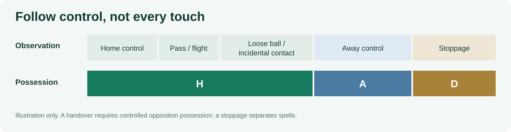

<p align="center">
  
</p>

<p align="center">
  <strong>Initial Challenge · Frame-level Ball Possession</strong><br>
  <a href="#the-approach">Approach</a> ·
  <a href="#reproduce-the-possession-file">Reproduce</a> ·
  <a href="#measured-evidence">Evidence</a> ·
  <a href="docs/MODEL_CARD.md">Model &amp; data</a> ·
  <a href="docs/technical-report.pdf">Technical report</a>
</p>

TRACE turns automatic tactical tracking into a complete **home / away / dead-ball / unknown** timeline. It combines learned ownership evidence with a constrained sequence decoder, aiming to recover whole possessions while retaining credible handovers.

The football distinction matters: a pass, loose ball, deflection or contested touch does not automatically transfer possession. The controlling team remains the owner until the opposition establishes control. The challenge evaluates whether those complete intervals are recovered—not simply whether nearby frames look similar.

| Input | Output | Primary metric | Runtime |
|---|---|---|---|
| Automatic tactical tracking TXT + XML metadata | `frame,label` CSV · 199,319 rows | Official **spellF1** | Offline CPU inference · Python 3.11.9 |

## The approach


1. **Establish live/dead support.** Player motion and geometric control evidence form a status timeline. Learned timing and interval-quality models refine its stoppages.
2. **Estimate team ownership.** A 330-feature model combines ball proximity, control evidence, temporal summaries, motion, visibility and missingness. A sequence decoder produces an initial H/A path with switch cost `0.9`.
3. **Estimate turnover evidence.** A separate model scores incoming H/A boundaries. Strong boundary evidence lowers the cost of a switch.
4. **Constrain the final path.** The decoder preserves the order and direction of initial handovers within ±`0.20 s` windows. Additional handovers must form complete return excursions under fixed `0.40 s` duration rules. Dead-ball and unknown support remain unchanged.
5. **Start a stoppage when the ball leaves the pitch.** Player movement reacts late to a stoppage. If, within 3 s before a predicted stoppage, the ball is tracked outside the pitch, or was last tracked within 2 m of a boundary line and is not tracked again, the stoppage starts 2 frames after the last in-pitch sighting. Nothing is fitted, and only live frames directly before a predicted stoppage can change.
6. **Apply one documented dead-ball window.** The organizers' [FAQ](https://github.com/metrica-sports/more-than-a-hack-2027/blob/main/FAQ.md) states that the second half is graded from frame `110,808` but does not kick off until `113,742`, and that those graded frames are dead ball. The final file labels that window `D`. The constant is the organizers' published one; no frame was inspected or labelled by the team.

This composition couples learned local evidence with explicit temporal structure. The constraints limit arbitrary edits and make the final path traceable; they do not guarantee that an initial predicted handover is correct. All parameters and five fitted models are fixed during inference. The method is offline and may use future observations.



| Label | Meaning |
|---|---|
| **H** | Home team possession |
| **A** | Away team possession |
| **D** | Dead ball; separates possession spells |
| **X** | Unknown / abstention |

The official scorer matches maximal H/A spells one-to-one by temporal overlap and averages F1 at IoU thresholds **0.3, 0.4, 0.5, 0.6 and 0.7**. Frame-level macroF1 is also reported and is the first tie-break. See the organizers’ [challenge definition](https://github.com/metrica-sports/more-than-a-hack-2027/blob/main/CHALLENGE.md) and [evaluation specification](https://github.com/metrica-sports/more-than-a-hack-2027/blob/main/EVALUATION.md).

## Reproduce the possession file

Use **64-bit CPython 3.11.9** and the pinned dependencies. The checked environment is Windows; a second machine and other operating systems have not been validated. No GPU, external service or training dataset is required for inference.

Clone this repository, then run the following from its root in PowerShell:

```powershell
python -m venv .venv
.\.venv\Scripts\python.exe -m pip install -r requirements-research-lock.txt

.\.venv\Scripts\python.exe -I -B infer_candidate.py `
  --data-dir "<authorized-bundle-root>" `
  --output "outputs/El Sendero del Padrón.csv"

.\.venv\Scripts\python.exe -I -B evaluation/validate_submission.py `
  "outputs/El Sendero del Padrón.csv"
```

On Linux or macOS the same four steps are:

```bash
python3.11 -m venv .venv
.venv/bin/python -m pip install -r requirements-research-lock.txt
.venv/bin/python -I -B infer_candidate.py --data-dir "<authorized-bundle-root>" --output "outputs/El Sendero del Padrón.csv"
.venv/bin/python -I -B evaluation/validate_submission.py "outputs/El Sendero del Padrón.csv"
```

The interpreter must be CPython 3.11.9 exactly; the package refuses to run otherwise. We have not run these commands on Linux or macOS ourselves. What we did check is that the output does not depend on the processor's instruction set or on the linear-algebra kernel: on the test machine the file is byte-identical with NumPy's optional CPU features disabled, with a generic BLAS kernel, single-threaded, and with all three together.

The organizer-provided bundle must have this layout; [DATA.md](DATA.md) explains authorized access and local placement:

```text
<authorized-bundle-root>/
└── tactical/
    ├── BAR-ATH_tactical_atd.xml
    └── BAR-ATH_tactical_atd.txt
```

The command checks packaged source/model hashes and the exact runtime, processes the raw tracking pair, and writes the CSV plus a local verification receipt. It refuses to overwrite an existing output. Generated outputs and match inputs are excluded from this repository.

The retained output is identified by:

| Check | Expected value |
|---|---|
| Header | `frame,label` |
| Data rows | **199,319** |
| Frames | **0–199318**, once each, in order |
| Labels | **H / A / D / X** |
| File size | **1,682,773 bytes** |
| SHA-256 | `60a794d19ff52e672f29525e8566c4292860a34d1692796f9277e7871b16fbfb` |

Eight runs from raw inputs regenerated these identical bytes on the checked host: three plain runs and five in a test that varies the processor and math-library settings (default, single thread, NumPy's optional CPU features disabled, a generic BLAS kernel, and the last three together). A run takes between half a minute and a minute and a half depending on the laptop's state; the bytes do not change. A clean installation of all 12 pinned distributions passed for the first edition, and no dependency has changed since. These checks establish reproducibility and output format; they do not establish accuracy against the private challenge labels.

## Measured evidence


| Same external development cohort | Status / geometry anchor | Learned owner | TRACE constrained |
|---|---:|---:|---:|
| Official spellF1, equal-match mean | 0.439622 | 0.512489 | **0.537786** |
| Original owner-cohort events retained | — | 408 / 408 | **405 / 408** |

The constrained stage adds **0.025297** absolute spellF1 over the immediate owner comparator. Three original matched events are lost; timing analysis retains the full original cohort and penalizes those losses rather than reporting only surviving events.

### Seven-match heads

The ownership and boundary heads in this release are fitted on the four Sportec matches plus Metrica Sports' three public sample matches. The change was accepted on a gate fixed in advance: at least +0.010 on held-out sample matches, no sample match lower, and at most 0.010 lost on the Sportec matches.

| Ownership and boundary heads fitted on | Sportec development, 3 matches | Metrica sample matches, each held out |
|---|---:|---:|
| Four Sportec matches (earlier editions) | 0.537786 | 0.610233 |
| **Seven matches** | **0.531989** | **0.643132** |

Every held-out sample match improves (from 0.636 to 0.655, from 0.604 to 0.639 and from 0.590 to 0.636). The Sportec figure falls by 0.006. Given the four Sportec matches alone and the model size of that edition, the fitting script reproduced the earlier heads exactly. Three held-out matches with clean tracking are thin evidence; the supplied match's tracking is automatic. These figures are for the models of the fourth edition (160 iterations, 15 leaves, before the ball-exit rule); the sections below add to them.

**Scope of the evidence.** These results use the same three repeatedly exposed Sportec development matches: J03WPY, J03WQQ and J03WR9. They are neither private challenge scores nor an independent generalization estimate. All seven external matches have been exposed during development. The organizer’s baseline was measured on a different match and is not a valid before/after comparator here.

The method can miss isolated stoppages, carry ownership through a real takeover, or preserve an incorrect initial transition. Cleaner external tracking and differences in provider control/restart conventions also limit transfer. The [technical report](docs/technical-report.pdf) explains the architecture, safeguards and observed trade-offs.

### Ball-exit onset

The status models decide stoppages from player movement, which reacts late. On held-out external matches our dead-ball onset was a median 8 to 22 frames later than the provider's, while the first frame with the ball outside the pitch precedes the provider's onset by a median 3 to 4 frames and falls within half a second of it in 90% of cases. Metrica's own sample tracking shows the same lateness: there a missing ball is the provider's dead-ball mark, and our onset was a median 25 to 32 frames late against it. The pipeline therefore starts a stoppage at the moment the tracking shows the ball leaving the pitch (step 5 above; [ball_exit.py](ball_exit.py)).

| Matches (models of the sixth edition, official spellF1) | Without the rule | With the rule |
|---|---:|---:|
| Sportec J03WPY, J03WQQ, J03WR9, held out | 0.531989 | 0.536550 |
| Metrica sample matches, each held out | 0.643132 | 0.652335 |
| Sportec J03WOH, J03WMX, J03WN1, J03WOY (replication on the status models' fitting matches) | 0.546375 | 0.551132 |

SpellF1 and macroF1 rise on all ten matches, and spellF1 rises in all 40 further runs with simulated ball loss. With the rule the median onset error is between -3 and +5 frames on every held-out match. **The rule did not reach the size we had set in advance** for the first six matches (+0.008 on the Sportec matches; it gave +0.005), so by that gate alone it would not have been adopted. Because it had improved every run, we repeated it unchanged on four further matches with the criterion, written first, that every match must improve; it did. We report both facts. With the models and the switching cost of this release the rule adds 0.004 on the Sportec held-out matches (0.561559 to 0.565928) and 0.010 on the Metrica ones (0.691677 to 0.701647).

On the supplied match the rule moves 28 stoppage onsets earlier by a median 19 frames (644 frames, 0.4% of graded frames; only live frames become dead ball). The exits lie on all four boundary lines, and the first outside sighting is at most 0.4 m beyond the line in 90% of cases, so they are line crossings and not high balls projected past the far touchline. This was measured without any label of the supplied match.

Perfect dead-ball status would add about 0.05 on the external matches, so most of that gap remains: stoppages that begin with a whistle are still found late, and some are missed.

### Larger ownership and boundary models, and the switching cost

The two models that decide which team has the ball were small (160 boosting iterations, 15 leaves), a setting fixed since the first edition. On 17 November it was tested by nested cross-validation: for each Metrica sample match in turn, the choice is made on the other two matches and scored on the one left out. The gates were written before each run: a mean gain of at least +0.008 on the held-out Metrica matches, none below -0.003, and a limit on any loss on the Sportec matches (0.005 in the first round, none in the second).

| Ownership and boundary models (seven matches, with the ball-exit rule; switching cost 0.6 unless stated) | Sportec held-out | Metrica held-out, event reference | Metrica held-out, provider dead ball |
|---|---:|---:|---:|
| 160 iterations, 15 leaves (sixth edition) | 0.536550 | 0.652335 | 0.611160 |
| 400 iterations, 31 leaves | 0.552509 | 0.669715 | 0.629017 |
| 800 iterations, 31 leaves (eighth edition) | 0.557311 | 0.682533 | 0.638169 |
| **800 iterations, 31 leaves, switching cost 0.9 (this release)** | **0.565928** | **0.701647** | **0.652915** |

"Provider dead ball" takes dead ball where Metrica's sample tracking has no ball and the owner from the events; it is the stricter of the two Metrica references.

The first step raised all six held-out matches (nested estimate +0.013). The second passed its gate more narrowly (nested estimate +0.009): four matches rise and two fall, by 0.003 and 0.0002. Tested and dropped along the way: Metrica matches counted double (helps the Metrica matches only), ownership targets limited to frames where the provider tracks a ball (-0.007 against the event reference), 12.5 training rows per second (no change), and 63 leaves (weaker than 31). Under simulated ball loss the larger models keep a gain in every scenario against the sixth edition's; the second step alone changes the Sportec matches by -0.003, -0.003 and +0.003 and the Metrica matches by +0.007, +0.005 and +0.008 (random loss, loss on hand-overs, loss placed as in the supplied match), inside the limit of -0.005 set in advance. The same six matches chose the size, so these remain development scores. [training/fit_heads_seven_matches.py](training/fit_heads_seven_matches.py) reproduces the released models exactly.

**The switching cost was raised from 0.6 to 0.9 by a team decision, outside the rule written in advance.** How readily possession changes hands is set by one number, fixed at 0.6 since the first edition. Tested on the same nested scheme, a higher cost scored better: with the released models 0.9 raises held-out spellF1 by 0.009 on the Sportec matches and by 0.015 on the Metrica ones (0.019 against the event reference), 5 of 6 held-out matches rise, and every simulated ball-loss scenario improves (+0.004 to +0.021). The rule we had written before the test does not select 0.9. It picks the cost with the best Metrica score, which is 1.2, and 1.2 failed a robustness condition (-0.013 on the four Sportec fitting matches with the 400-iteration models, -0.010 with the released ones; limit -0.005). By that rule the cost would have stayed at 0.6. We chose 0.9 after seeing these results, because the gain appears in both data families, under every loss scenario and at the neighbouring values 0.75 and 1.05, and because 0.9 stays inside every limit that had been set for the registered choice (-0.002 on the fitting matches). This is a judgement on the same six matches that produced the numbers, so the gain is probably overstated. One held-out match falls (J03WR9, -0.009), and the file holds about 10% fewer possessions than at 0.6.

**The dead-ball models were tested at the larger size and kept as they are.** Status and timing models with 400 iterations and 31 leaves gain 0.009 on the Sportec matches and lose 0.002 on the Metrica ones; the gate failed.

### Checks on the supplied match

No model was trained or fitted on the supplied match, and no label of it was used to choose anything in the released file.

**What the evaluation rewards.** The ranking metric counts each possession once, however long. The organizers publish that a perfect file delivered one second late scores only 0.654, which is possible only if many reference possessions last just a few seconds. Scoring labels against a one-second-late copy of themselves gives 0.557 for the Sportec provider field, 0.627 and 0.679 for possession derived from Metrica's sample events, and 0.748 once opponent runs under three seconds are removed. The released file gives 0.692 (0.641 before the switching cost was raised). No parameter was fitted to these figures; they were used to decide whether brief possessions belong in the file. The switching cost was chosen on external matches, not from this figure; we note that at 0.9 the file sits further above the published 0.654 than it did at 0.6.

**One pipeline check, and a rule that was withdrawn.** The official evaluator was run once on the public five-minute window, on the second edition, to confirm frame alignment and label meaning: macroF1 `0.8504`, alive/dead F1 `0.9687`, matched hand-overs a median 2 frames late, spellF1 `0.4182` on 17 possessions with 27 predicted. Seventeen possessions cannot rank methods. Because that reading showed more predicted possessions than reference ones, a rule absorbing opponent runs under three seconds was added and published as a third edition. Two external benchmarks then showed it removes real possessions (Sportec development 0.538 without the rule, 0.475 with it; Metrica sample matches 0.610 without, 0.560 with), and the delay figures above say the same. The rule was withdrawn and is not in this release. The released file was not scored on the public window.

**Earlier checks on 17 November, before the larger models.** Further tests were run on external matches only, each against a gate written in advance. First, the ball was removed from held-out external matches as often as the supplied tracking loses it (12% of live frames in gaps with a 2.5 s median, 76% of dead frames). SpellF1 falls by 0.03 to 0.09, most when the loss falls on hand-overs, and neither a 2 s nor a 3 s minimum-control rule helps (best change +0.003 against a required +0.010). Second, heads fitted on all ten external matches gain 0.010 on the Sportec matches and lose 0.007 on the Metrica sample matches; the gate allowed a loss of 0.005, so they were not adopted. Third, heads fitted on clean plus ball-loss views gain 0.007 to 0.009 under random loss but lose 0.013 on clean Metrica tracking and 0.010 when the loss falls on hand-overs; not adopted. Fourth, the three dead-ball models were refitted with Metrica's sample matches added, taking dead ball where the provider's tracking has no ball. The refit on the four Sportec matches reproduced the released models exactly; with the Metrica matches added, held-out Metrica matches changed by -0.002 and the Sportec matches by -0.007, so the released models were kept. The [technical report](docs/technical-report.pdf) shows each result as a chart.

**What the larger models and the switching cost change in the file.** Against the sixth edition the released file differs on 6,616 frames (4.2% of graded frames), against the eighth on 1,489. All of them are home/away labels; dead-ball and unknown frames are identical, so the stoppages and the ball-exit onsets are unchanged. It holds 397 possessions (433 in the sixth edition, 439 in the eighth) with a median of 5.04 s. Measured without any label of the supplied match.

Smart Tagging and the second-camera tracking were analysed and not used for the file. Tagged set pieces already coincide with predicted restarts in 53 of 58 cases, and the broadcast ball fills only 5–9% of frames where the tactical ball is missing. The [technical report](docs/technical-report.pdf) lists every asset and idea that was tried and dropped, with the test and the result, and the history of the published editions.

## Models and external data

Five bundled models cover **status**, **timing**, **interval quality**, **ownership** and **turnover boundaries**. Status, timing and interval quality are fitted on four external Sportec Open DFL matches: J03WOH, J03WMX, J03WN1 and J03WOY. Ownership and turnover boundaries are fitted on those four plus Metrica Sports' three public sample matches. Supplied challenge possession labels and video are not training inputs.

The Metrica sample matches come from [metrica-sports/sample-data](https://github.com/metrica-sports/sample-data); we acknowledge Metrica Sports as their source. File identities are in [metrica-sample-assets.json](metrica-sample-assets.json). Their targets are derived from Metrica's human-coded event data by a fixed rule implemented in [training/fit_heads_seven_matches.py](training/fit_heads_seven_matches.py): possession changes only at a RECOVERY or SET PIECE of the other team, and the ball is dead from the end of the event before each set piece to that set piece. The events are Metrica's; the frame-level derivation is ours. The data is not redistributed here.

The targets come from provider `BallStatus` and `BallPossession` fields, mechanically mapped into H/A/D/X. They are not new manual annotations by this team. Their complete frame-level annotation/correction workflow is not established by the available source documentation. See the [model and data card](docs/MODEL_CARD.md) for the exact mapping, training roles and limitations, and [external asset identities](sportec-required-assets.json) for versioned source references.

The external dataset is [Bassek et al. (2025), *An integrated dataset of spatiotemporal and event data in elite soccer*](https://doi.org/10.1038/s41597-025-04505-y), [dataset v1](https://doi.org/10.6084/m9.figshare.28196177.v1), licensed under [CC BY 4.0](https://creativecommons.org/licenses/by/4.0/). It is not redistributed here.

## Repository map

```text
infer_candidate.py           Raw tracking → possession CSV
candidate_pipeline.py        Fixed inference composition and integrity checks
owner_model.py               Ownership features, estimator type and decoder
adaptive_turnovers.py        Turnover evidence model
constrained_turnovers.py     Constrained temporal decoder
ball_exit.py                 Stoppage onset when the ball leaves the pitch
documented_structure.py      Organizer-documented second-half kick-off window
training/                   Script that fitted the ownership and boundary heads
metrica-sample-assets.json  Identities of the Metrica sample files used for training
research_possession/         Tracking, status and timing components
models/                     Five fitted artifacts and boundary provenance
evaluation/                 Official metrics and CSV validator
docs/                       Technical report, model card and figures
artifacts.json              Package source/model integrity manifest
```

## Team and attribution

**El Sendero del Padrón** — Oikantik Basu · Aniket Pal · Sayan Chakraborty

Prepared for the [More Than A Hack 2027 Initial Challenge](https://github.com/metrica-sports/more-than-a-hack-2027), organized by Metrica Sports and Barça Innovation Hub.

TRACE is distributed under the repository’s [MIT licence](LICENSE). Included organizer code retains its [Metrica Sports licence](licenses/METRICA_LICENSE). The separate external-data attribution and rights boundaries are recorded in [NOTICE.md](NOTICE.md). Match assets and generated submission predictions are not distributed in this public repository.
